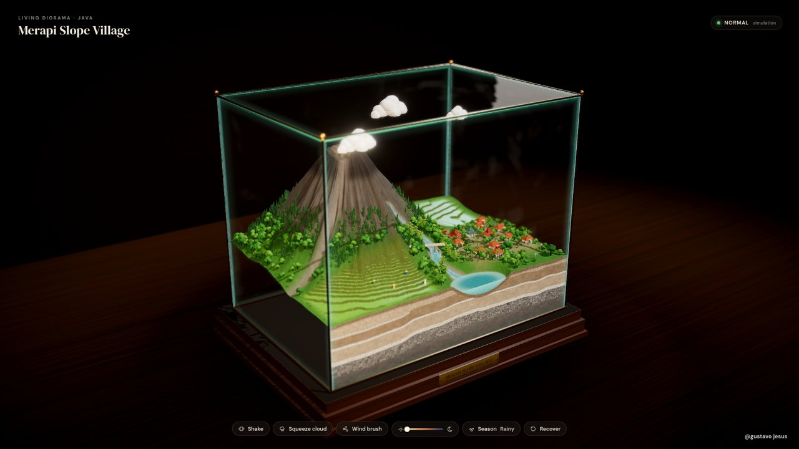
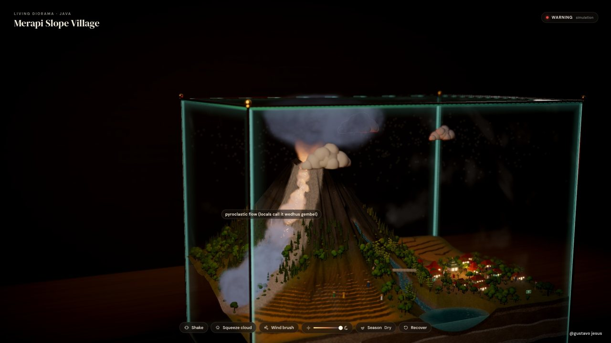
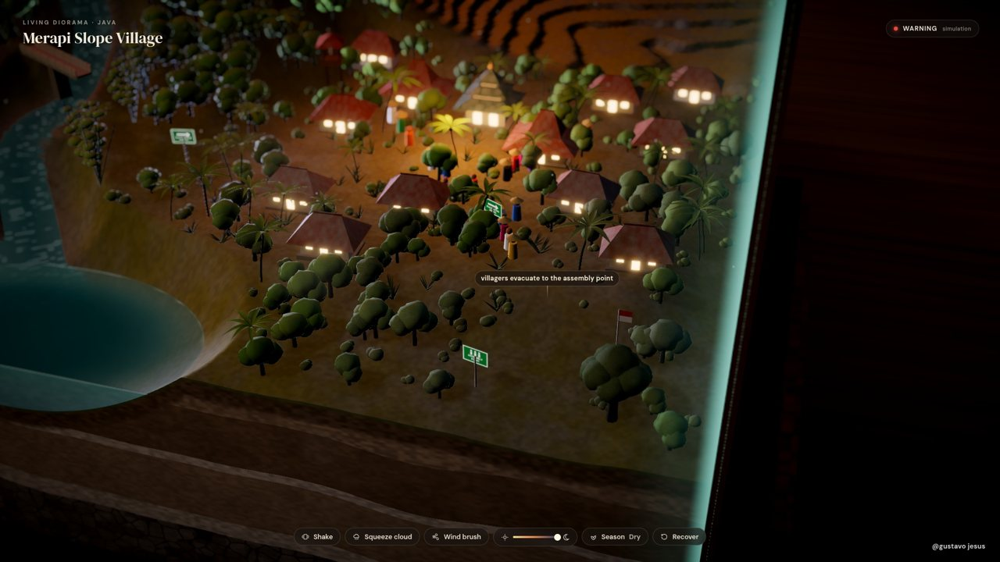
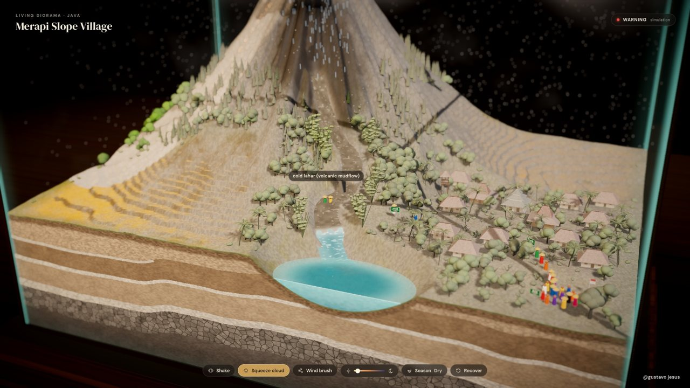

# Merapi Slope Village, a living diorama

An interactive Three.js miniature of a Javanese village on the slope of Mount Merapi, Indonesia's most active volcano, sealed inside a glass display box. Shake the box and the lava dome wakes up, a pyroclastic flow rolls down the valley away from the village, ash greys the roofs and the villagers walk to the assembly point. Squeeze a cloud and the rain turns the ash into a cold lahar (volcanic mudflow) down the river into the lake. Press Recover and the green slowly comes back.

**Live demo:** https://gustavojesuss69.github.io/merapi-diorama/

| | |
|---|---|
|  |  |
|  |  |

## What is in the box

- The cone of Merapi with a glowing lava dome, a smoking crater and a pyroclastic flow gully (locals call these flows *wedhus gembel*, "shaggy sheep", because the clouds roll like lumpy wool)
- Terraced rice fields, salak palms, bamboo, coconut, casuarina and a big banyan tree
- Javanese houses with tile roofs, a small prayer house, a kentongan (bamboo slit-drum alarm) watch tower, evacuation route and assembly point signs
- A river with a bridge and sand-mining trucks, ending in a lake
- A cutaway side showing volcanic soil layers (ash bands and lava rock)
- A glass box with reflections, edge highlights and a brass frame on a wooden plinth, plus tilt-shift depth of field, bloom and volumetric-looking ash

Everything is procedural, with no 3D model files. The whole scene is built in code from noise, simple geometry and custom shaders.

## Controls

| Action | How |
|---|---|
| Eruption | Grab the box and shake it fast, press **Shake**, or press `S` |
| Rain and lahar | Drag a cloud over the volcano and hold still to squeeze it, or press **Squeeze cloud** |
| Wind | Press **Wind brush** (or `W`) and paint across the scene, which bends the ash plume and sways the trees |
| Day and night | Drag the sun/moon slider |
| Season | Toggle **Season** between rainy and dry (the rice fields change) |
| Recover | Press **Recover** (or `R`) to wash the ash away and regrow the green |
| Camera | Drag empty space to orbit, scroll to zoom |

The status chip (Normal, Advisory, Alert, Warning) follows Indonesia's four volcano alert levels. Here it is only a simulation.

## Run it locally

Requires Node.js 20 or newer.

```bash
npm install
npm run dev       # dev server at http://localhost:5297
npm run build     # static build in dist/ (relative paths, host anywhere)
npm run preview   # serve dist/ at http://localhost:5297
```

`dist/` is plain static files, so any static host works. Opening `dist/index.html` straight from disk does not work, because ES modules need http.

## Deploying

Each push to `main` runs `.github/workflows/deploy.yml`, which builds with Vite and publishes `dist/` to GitHub Pages. In a fork, set **Settings → Pages → Source** to **GitHub Actions**.

## Rendering the video

The 57 second 1080p video is rendered frame by frame from a deterministic script, so every frame is reproducible.

1. `npm run build && npm run preview` (keep it running)
2. In another terminal: `npm run render -- from=0 to=1710 dir=frames`. This needs Google Chrome at `/usr/bin/google-chrome` and renders through SwiftShader, so it is slow (a few seconds per frame). You can split the range across several processes, and frames that already exist are skipped.
3. `pip install numpy scipy && npm run audio` writes `out/audio_raw.wav`
4. `npm run encode` (needs ffmpeg) writes `out/merapi-diorama.mp4`

Single stills: `npm run render -- stills=400,936 out=test`.

The video timeline (camera path, cursor, clicks, clouds, labels) is in `src/script.js`. The simulation is in `src/sim.js`.

## Project layout

```
index.html        UI overlay (title, status, buttons, labels, end card)
src/main.js       renderer, scene, post-processing, scripted video mode
src/live.js       interactive mode (orbit, drag clouds, shake, wind brush)
src/sim.js        deterministic simulation (eruption, ash, rain, lahar, villagers, recovery)
src/terrain.js    terrain, river, lake, cutaway walls and their shaders
src/props.js      houses, prayer house, tower, bridge, signs, vegetation, villagers, truck
src/box.js        glass vitrine, brass frame, plinth nameplate, room
src/fx.js         smoke and flow particles, clouds, lava dome, rain, ash, embers, lightning
src/script.js     the video timeline
render.mjs        headless frame renderer (Puppeteer)
tools/audio.py    procedural soundtrack
tools/encode.sh   ffmpeg encode
docs/sources.md   fact sources
```

## Credits and sources

- Built with [Three.js](https://threejs.org/), [postprocessing](https://github.com/pmndrs/postprocessing) and [Vite](https://vitejs.dev/)
- Fonts: DM Sans and DM Serif Display (SIL Open Font License)
- Volcano facts (location, activity, the *wedhus gembel* name, rain-triggered lahars and sand mining) are listed with links in [docs/sources.md](docs/sources.md). The village layout, eruption timing and lahar speed are artistic licence.

## License

MIT © 2026 Gustavo Jesus
